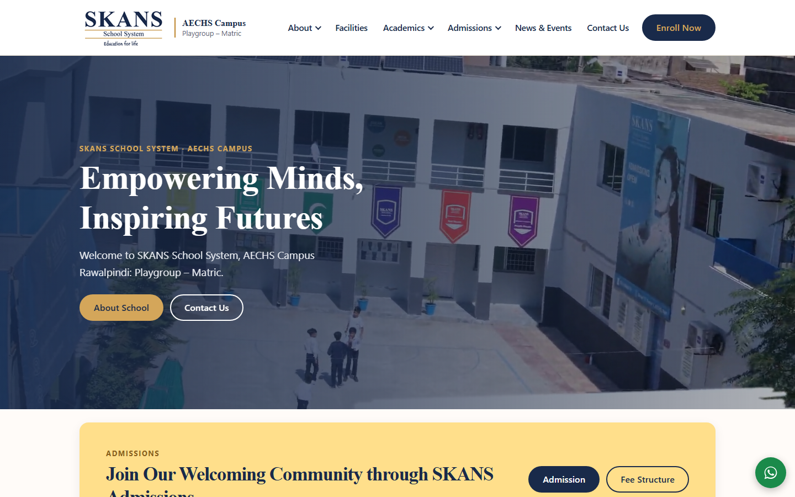
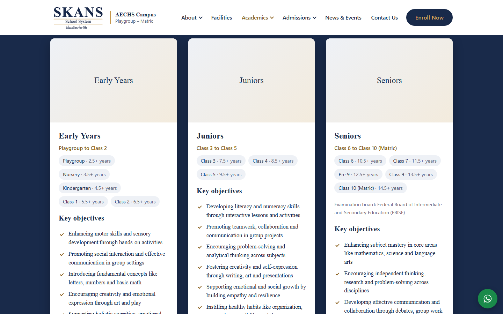
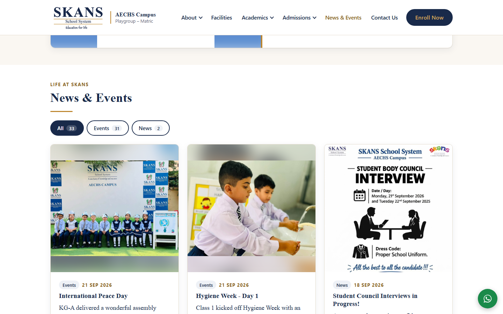
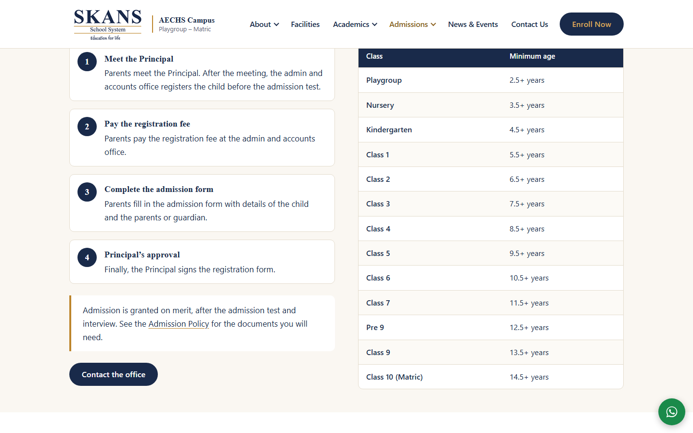
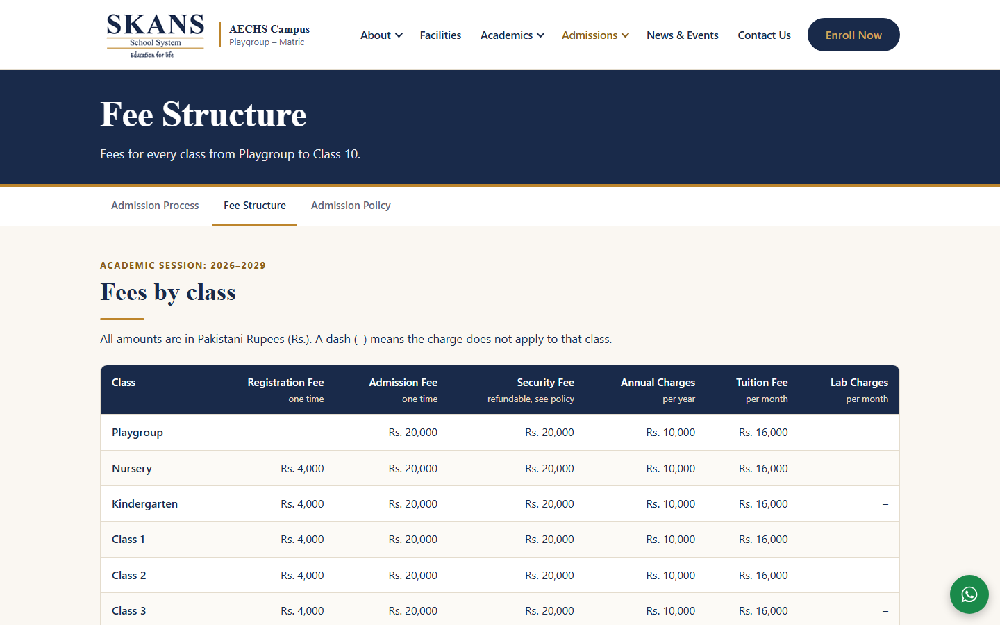
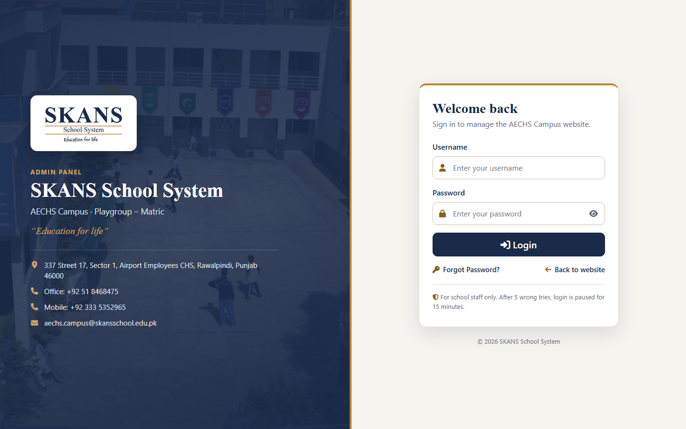
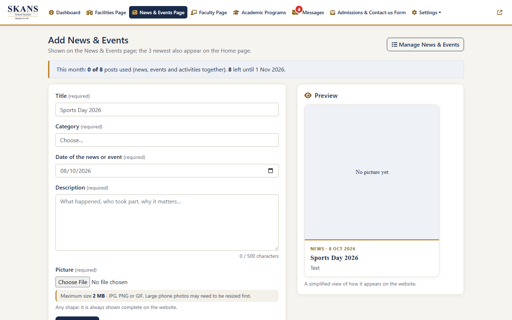
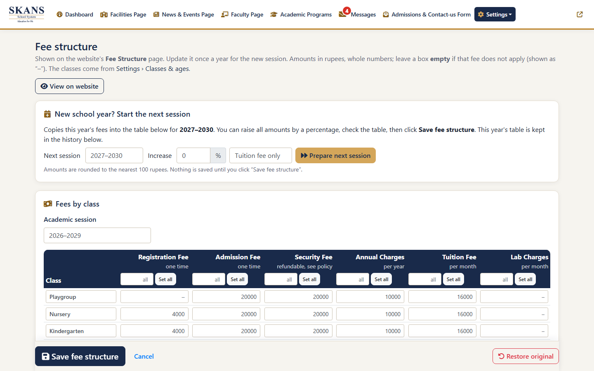
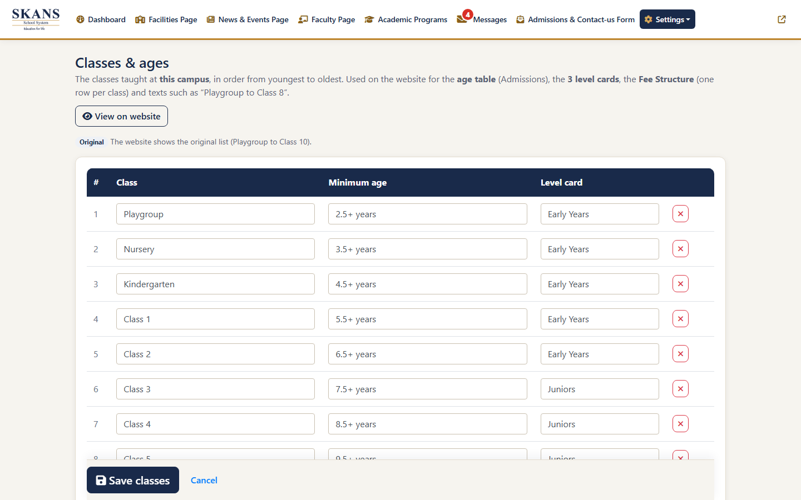
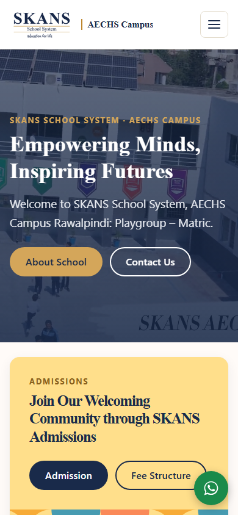

# SKANS School System: campus website and admin panel

A complete redesign of the website and admin panel for **SKANS School System** campuses (Rawalpindi / Islamabad, Pakistan).
One set of code runs **every campus**: each campus has its own web address, database, pictures and settings,
and the school office updates everything from a simple admin panel without touching code.

Live campuses: **AECHS Campus** and **PWD Campus** (more SKANS campuses can be added the same way).

---

## Screenshots

| Website | |
|---|---|
|  |  |
| **Programs offered:** Early Years, Juniors, Seniors | **News & Events:** filters, 12 cards at a time, "Show more" |
|  |  |
| **Admissions:** steps and age guide per class | **Fee structure:** per class, grouped into cards on phones |

| Admin panel | |
|---|---|
|  |  |
| **Login** with lock-out after 5 wrong passwords | **One modern form** for news, activities, facilities and faculty, with a live preview |
|  |  |
| **Fee structure editor:** "Set all", "Prepare next session" (+%), history | **Classes & ages:** each campus's own classes; the website follows |

<em>Fully responsive: tested at 320, 360, 768 and 1280 px wide.</em>

---

## What the school can do (admin panel)

- **News & Events, co-curricular activities, facilities, faculty, announcements:** add, edit, bulk delete, search, filter and page through them; pictures are checked (real image, max 2 MB) and never stretched on the website.
- **Monthly post limit** (news + activities, default 8 a month, changeable).
- **Announcements** leave the website automatically after 30 days (they stay saved); the newest can show as a **pop-up** on the Home page.
- **Settings:** campus name, address, phones, WhatsApp, email, map and social links; **fee structure** with yearly update; **admission policy**; **principal's message and photo**; **classes and minimum ages**.
- **Academic Programs:** entries #1–#3 are the three level cards (title, classes, key objectives, picture).
- **Contact messages** with a red "new" badge, remarks and replies.
- **Automatic daily database backups** (kept 30 days) plus "Back up now" and download.
- **Dashboard:** posts this month, new messages, live announcements, last backup, visitors, charts.

## Website features

- New design in the SKANS brand (navy `#192A4A`, gold `#BD852C`, Times New Roman headings).
- Long paragraphs (more than 3 lines) switch to Times New Roman automatically for easier reading.
- Each campus shows its **own** name, city, classes ("Playgroup to Class 8"), fees and contact details: no campus name is fixed in the code.
- Contact form with spam protection; Google-friendly page titles and descriptions per campus.

## Security

- Prepared statements for every database query; CSRF tokens on every admin form; output escaped.
- Passwords hashed; lock-out after 5 wrong logins in 15 minutes; logout after 60 minutes idle; secure session cookies.
- Uploads: real file-type check, random file names, no scripts can run in picture folders.
- **No passwords in the code:** each campus's database and email login live in `campus-data/<campus>/config.php`, which is blocked from the web and **not** in this repository.

## Built with

PHP 8 (no framework) · MariaDB / MySQL · HTML, CSS, vanilla JavaScript · Bootstrap 4 and Chart.js (admin) · PHPMailer.
Runs on ordinary cPanel shared hosting.

---

## Run it on your computer (XAMPP)

1. Put this folder in `C:\xampp\htdocs\…` and start **Apache** and **MySQL** in XAMPP.
2. In phpMyAdmin, create a database and import the school's database export (`.sql`), then run
   `docs/sql/2026-10-go-live-1-schema.sql` (adds the settings tables; the site also does this itself on first admin login).
3. Create the two campus files (they are not in the repository because they hold passwords):
   - `campus-data/sites.php`: copy `docs/deploy/sites.php.example`, use `'localhost' => 'aechs'`
   - `campus-data/aechs/config.php`: copy `docs/deploy/config.php.example`, fill in the database login.
     **The first line must be `<?php`.**
4. Copy the pictures into `adminpanel/upload/images/` (not in the repository: they are the school's photos).
5. Open `http://localhost/<folder>/` and the admin panel at `/adminpanel/`.

## Put it on a server / add a campus

Step-by-step guides (cPanel, database queries, testing, undo):
[`docs/deploy.md`](docs/deploy.md) · [`CAMPUS-SWITCH-STEPS.txt`](docs/deploy/CAMPUS-SWITCH-STEPS.txt) · SQL in order: [`docs/sql/go-live/`](docs/sql/go-live/) · upload zip: `powershell -ExecutionPolicy Bypass -File docs\build-release.ps1`.
A full illustrated guide for the school office is in `docs/SKANS-AECHS-Website-and-Admin-Guide.pdf`.

---

## Folder map

| Folder / file | What's inside |
|---|---|
| `index.php`, `about.php`, `services.php`, `faculty.php`, `news-events.php`, `contact-us.php`, `admissions.php`, `admission-policy.php`, `fee-structure.php`, `departments.php`, `advanced-placement-program.php`, `policies.php` | The website pages (their names are the page addresses: don't rename) |
| `includes/` | Shared code: header, footer, `campus.php` (which campus this address is), `settings.php` (admin settings, fees, classes, level cards), card templates |
| `data/` | Default content for a new campus: `site.php` (levels, classes, subjects), `fees.php` (fees and policy text) |
| `assets/` | `css/site.css` (the whole design), `js/site.js`, `img/`, `video/` (Home video), `docs/` (public PDFs) |
| `css/` | Old stylesheet still used by the Home page |
| `adminpanel/` | The admin panel (pages and helpers: login, forms, backups, settings) |
| `vendor/` | PHPMailer (password-reset email) |
| `downloads/` | Admission form files (closed to the web for now) |
| `campus-data/` | Per campus: `config.php` (passwords, **not in the repository**), pictures, backups. `sites.php` maps web address → campus |
| `docs/` | Audit, redesign plan, deployment guides, SQL scripts, screenshots, PDF guide (closed to the web) |

**Not in the repository (see `.gitignore`):** campus passwords, database backups, uploaded pictures and student photos, release zips, old file versions.

## Where to change things

- **School details, fees, classes, policy, principal's message, news, faculty…:** the admin panel (each campus separately).
- **Design:** `assets/css/site.css`. **Page wording/layout:** the page file in the root folder.
- **Defaults for a new campus:** `data/site.php`, `data/fees.php`. **Add a campus:** a folder in `campus-data/` + one line in `campus-data/sites.php`.

---

Developed for SKANS School System, October 2026.
